<div align="center">


# FlowableLab

**Execução e visualização de workflows BPMN 2.0 com Flowable Open Source incorporado ao Spring Boot**


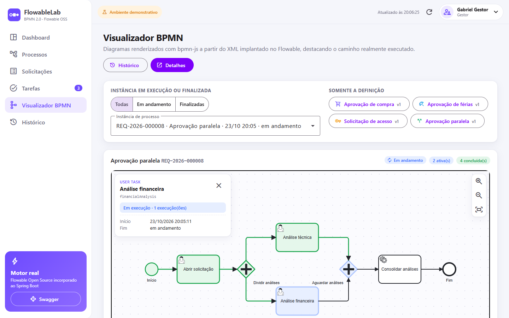

</div>

---

## Sumário

1. [O que é o FlowableLab](#1-o-que-é-o-flowablelab)
2. [O que é o Flowable Open Source](#2-o-que-é-o-flowable-open-source)
3. [O que é BPMN 2.0](#3-o-que-é-bpmn-20)
4. [Tecnologias utilizadas](#4-tecnologias-utilizadas)
5. [Arquitetura da aplicação](#5-arquitetura-da-aplicação)
6. [Estrutura de pastas](#6-estrutura-de-pastas)
7. [Como clonar o repositório](#7-como-clonar-o-repositório)
8. [Como configurar o `.env`](#8-como-configurar-o-env)
9. [Como executar com Docker Compose](#9-como-executar-com-docker-compose)
10. [Como acessar o Angular](#10-como-acessar-o-angular)
11. [Como acessar o Swagger](#11-como-acessar-o-swagger)
12. [Como iniciar um processo](#12-como-iniciar-um-processo)
13. [Como aprovar ou rejeitar tarefas](#13-como-aprovar-ou-rejeitar-tarefas)
14. [Como visualizar o BPMN](#14-como-visualizar-o-bpmn)
15. [Como consultar o histórico](#15-como-consultar-o-histórico)
16. [Como executar os testes](#16-como-executar-os-testes)
17. [Como consultar os logs](#17-como-consultar-os-logs)
18. [Como reiniciar o ambiente](#18-como-reiniciar-o-ambiente)
19. [Como limpar os dados demonstrativos](#19-como-limpar-os-dados-demonstrativos)
20. [Limitações de segurança do MVP](#20-limitações-de-segurança-do-mvp)

Extras: [BFF NestJS](#bff-nestjs) · [os quatro workflows](#os-quatro-workflows) · [API REST](#api-rest) · [tratamento de erros](#tratamento-de-erros) · [solução de problemas](#solução-de-problemas)

---

## 1. O que é o FlowableLab

O FlowableLab é uma aplicação full stack educacional que mostra, na prática, como processos BPMN 2.0 são
executados por um motor de workflow real. Com ele você:

- inicia solicitações corporativas (compra, férias, acesso, aprovação paralela);
- executa tarefas humanas aprovando, rejeitando ou concluindo etapas com perfis diferentes;
- vê o diagrama BPMN com as atividades **ativas em azul**, **concluídas em verde** e **com falha em vermelho**;
- acompanha a timeline completa do histórico e indicadores em um dashboard.

> Nada é simulado: todas as instâncias, tarefas, decisões e históricos são criados e consultados no
> **Flowable Open Source** e persistidos no **PostgreSQL**.

| Dashboard | Tarefas |
|---|---|
| 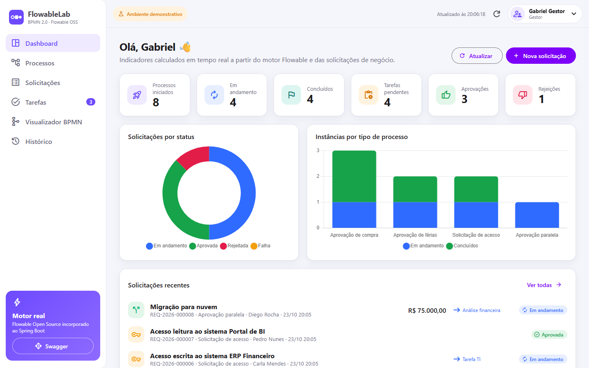 | 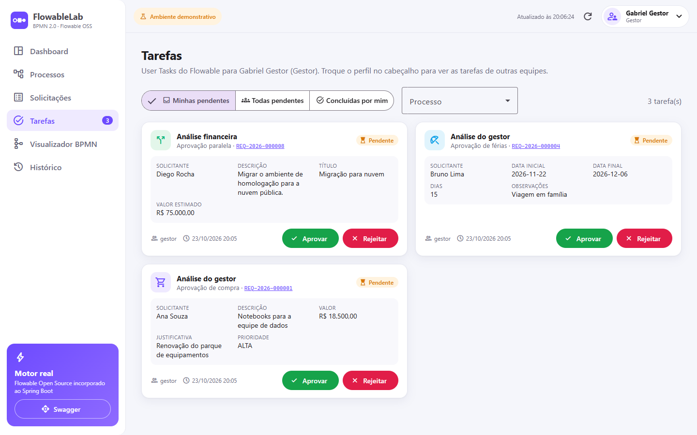 |

## 2. O que é o Flowable Open Source

O [Flowable](https://www.flowable.com/open-source) é um motor de processos de código aberto (Apache 2.0), escrito
em Java, que executa modelos **BPMN 2.0**, **CMMN** e **DMN**. Ele guarda definições, instâncias, tarefas,
variáveis e histórico em banco relacional e expõe serviços Java para controlar tudo isso.

Neste projeto o Flowable roda **incorporado** ao Spring Boot por meio do starter oficial
`flowable-spring-boot-starter-process`. **Não existe** servidor ou contêiner Flowable separado, e nenhum
recurso do Flowable Enterprise é utilizado. A aplicação usa apenas os serviços oficiais
(`RuntimeService`, `RepositoryService`, `TaskService`, `HistoryService`, `ManagementService`) — as tabelas
internas `ACT_*` nunca são lidas ou alteradas diretamente.

## 3. O que é BPMN 2.0

**BPMN (Business Process Model and Notation) 2.0** é o padrão da OMG para modelar processos de negócio de
forma visual **e executável**. Um arquivo BPMN é um XML que contém:

- a **semântica** do processo — eventos, tarefas, gateways e fluxos;
- o **diagrama (BPMN DI)** — posições e conexões, usadas para desenhar o fluxo (aqui, pelo bpmn-js).

Elementos usados no FlowableLab:

| Elemento | Para que serve | Onde aparece |
|---|---|---|
| Start / End Event | Início e fim do processo | Todos |
| **Service Task** | Etapa automática executada por código Java | Validação automática, Registro RH, Conceder acesso |
| **User Task** | Etapa executada por uma pessoa ou grupo | Análise do gestor, Tarefa TI, Análises |
| **Exclusive Gateway** | Escolhe **um** caminho conforme uma condição | Aprovado? / Rejeitado? |
| **Parallel Gateway** | Divide em ramos simultâneos e **espera todos** na junção | Aprovação paralela |
| Async + retry | Executa em segundo plano, com retentativas | Registro RH |

## 4. Tecnologias utilizadas

As versões foram escolhidas pela **compatibilidade oficial**: o Flowable 8.0.0 é compilado contra
Spring Boot 4.0.x (Spring Framework 7, Jackson 3) e suporta Java 17+. Por isso o backend usa a última
versão da linha **4.0**, e não a 4.1. O BFF usa o **NestJS 11.2** (CommonJS, compatível com Jest/ts-jest):
o NestJS 12 passou a ser distribuído apenas como ESM e é muito recente.

| Camada | Tecnologia | Versão |
|---|---|---|
| Backend | Java (Eclipse Temurin) | 25 |
| | Spring Boot (Web MVC, Data JPA, Validation, Actuator) | 4.0.9 |
| | Flowable Open Source BPMN Engine (starter process) | 8.0.0 |
| | springdoc-openapi (Swagger UI) | 3.0.3 |
| | Flyway · Hibernate · PostgreSQL JDBC | gerenciados pelo Boot 4.0.9 |
| | JUnit 5 · Mockito · AssertJ · Awaitility | gerenciados pelo Boot 4.0.9 |
| | Testcontainers (PostgreSQL) | 2.0.x |
| | Maven (wrapper) | 3.9.11 |
| Frontend | Angular (standalone, Signals, zoneless) | 22.2 |
| | Angular Material + CDK (tema M3) | 22.2 |
| | bpmn-js (NavigatedViewer) | 18.x |
| | Chart.js | 4.6 |
| | TypeScript · RxJS · SCSS · Vitest | 6.0 · 7.8 · — · 5 |
| BFF | NestJS (platform-express / Express 5) | 11.2 |
| | Node.js (LTS) · TypeScript | 24 · 5.9 |
| | Jest · ts-jest · Supertest | 30 · 29 · 7 |
| Infra | PostgreSQL | 17.6 (alpine) |
| | Nginx | 1.29 (alpine) |
| | Docker Compose · GitHub Actions | — |

## 5. Arquitetura da aplicação

**Angular → NestJS (BFF) → Spring Boot + Flowable → PostgreSQL**

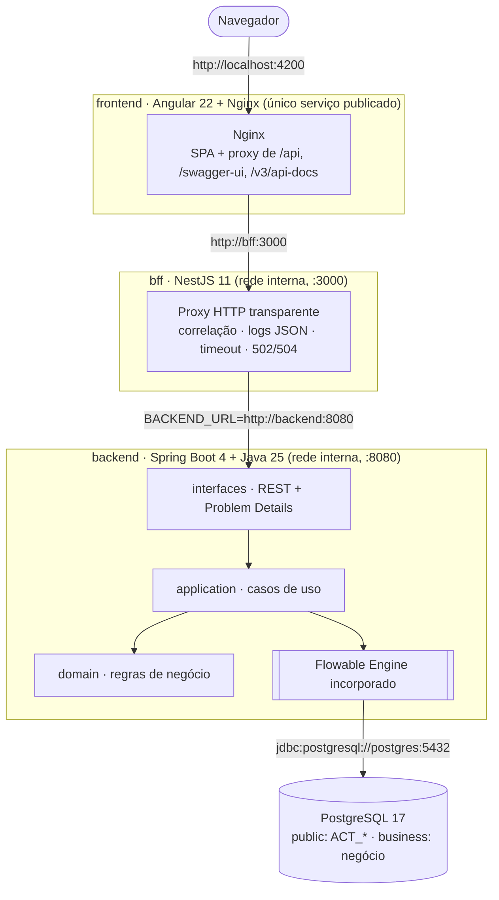

| Camada | Responsabilidade | Não faz |
|---|---|---|
| **Angular** (`frontend/`) | Telas, formulários, estado com Signals, visualizador bpmn-js. Chama apenas `/api` na própria origem. | Não conhece o endereço do BFF nem do backend |
| **Nginx** (`frontend/nginx.conf`) | Serve o build do Angular e encaminha `/api`, `/swagger-ui` e `/v3/api-docs` ao BFF | Não fala com o backend |
| **BFF NestJS** (`bff/`) | Proxy transparente para o Spring Boot: preserva métodos, paths, query strings, corpos, cabeçalhos e status; adiciona `X-Correlation-Id`, logs estruturados, timeout e respostas 502/504 | Não contém regra de negócio, não acessa o Flowable nem o banco, não reenvia requisições |
| **Spring Boot + Flowable** (`backend/`) | Regras de negócio, validação de perfis, execução dos workflows BPMN | — (inalterado em relação à V1) |
| **PostgreSQL** | Tabelas do Flowable (`public`) e de negócio (`business`) | — |

**Arquitetura hexagonal** no backend:

- **domain** — entidades e objetos de valor com as regras de negócio (valor > 0, períodos de férias, rejeição
  exige justificativa, quem pode concluir cada tarefa, cálculo do caminho executado). Sem dependência do Flowable.
- **application** — casos de uso e portas (`ProcessEnginePort`, `TaskPort`, repositórios).
- **infrastructure** — adaptadores do Flowable, delegates das Service Tasks, listeners, JPA/Flyway, dados demonstrativos.
- **interfaces** — controllers REST, DTOs e Problem Details.

Detalhes como a correlação `businessKey` ↔ solicitação, a consistência transacional, o tratamento de jobs com
falha e o algoritmo do visualizador estão em **[docs/ARCHITECTURE.md](docs/ARCHITECTURE.md)**.

## 6. Estrutura de pastas

```text
flowablelab/
├── backend/                         Spring Boot + Flowable
│   ├── src/main/java/com/flowablelab/
│   │   ├── domain/                  regras de negócio (sem Flowable)
│   │   ├── application/             casos de uso e portas
│   │   ├── infrastructure/          Flowable, JPA, configuração, dados demo
│   │   └── interfaces/              REST, DTOs, Problem Details
│   ├── src/main/resources/
│   │   ├── processes/               4 arquivos *.bpmn20.xml (com BPMN DI)
│   │   ├── db/migration/            Flyway (schema business)
│   │   └── application.yml
│   ├── src/test/                    unitários, Mockito, Testcontainers
│   ├── Dockerfile                   build multi-stage Maven → JRE 25
│   └── pom.xml
├── frontend/                        Angular 22
│   ├── src/app/
│   │   ├── core/                    API, Signals stores, interceptor, catálogo
│   │   ├── shared/                  bpmn-viewer, timeline, cards, chips, gráficos
│   │   ├── layout/                  menu lateral + cabeçalho com seletor de perfil
│   │   └── features/                dashboard, processes, requests, tasks, history
│   ├── nginx.conf                   SPA + proxy para o BFF
│   ├── proxy.conf.json              proxy do `ng serve` para o BFF (desenvolvimento)
│   ├── Dockerfile                   build Angular → Nginx
│   └── package.json
├── bff/                             Backend for Frontend (NestJS)
│   ├── src/
│   │   ├── config/                  leitura e validação das variáveis de ambiente
│   │   ├── proxy/                   controller @All + serviço de proxy (node:http, streaming)
│   │   ├── observability/           X-Correlation-Id e log JSON por requisição
│   │   ├── health/                  /bff/health e /bff/health/ready
│   │   ├── app.module.ts
│   │   └── main.ts
│   ├── test/
│   │   ├── proxy.spec.ts            proxy contra um backend HTTP de teste
│   │   └── regression/              cenários A–E contra o Docker Compose
│   ├── Dockerfile                   build TypeScript → Node 24
│   └── package.json
├── docs/                            arquitetura, exemplos REST, imagens
├── scripts/                         start/reset (sh e ps1)
├── .github/workflows/ci.yml         testes + build + smoke test e regressão do Compose
├── docker-compose.yml               ambiente completo (só o frontend publicado)
├── docker-compose.dev.yml           publica BFF, backend e PostgreSQL para desenvolvimento
├── .env.example
└── LICENSE
```

## 7. Como clonar o repositório

Pré-requisitos: **Git** e **Docker** com Docker Compose v2
([Docker Desktop](https://www.docker.com/products/docker-desktop/) no Windows/macOS, Docker Engine no Linux).
Não é preciso instalar Java, Maven, Node.js, Angular CLI nem PostgreSQL.

```bash
git clone https://github.com/<seu-usuario>/flowablelab.git
cd flowablelab
```

## 8. Como configurar o `.env`

```bash
# Linux / macOS / Git Bash
cp .env.example .env

# Windows PowerShell
Copy-Item .env.example .env
```

| Variável | Padrão | Descrição |
|---|---|---|
| `POSTGRES_DB` / `POSTGRES_USER` / `POSTGRES_PASSWORD` | `flowablelab` / `flowablelab` / `flowablelab-local-only` | Credenciais **apenas do ambiente local** |
| `FRONTEND_PORT` | `4200` | Porta publicada do frontend (única exposta por padrão) |
| `POSTGRES_PORT` · `BACKEND_PORT` · `BFF_PORT` | `5433` · `8080` · `3000` | Portas publicadas **somente** com `docker-compose.dev.yml` |
| `BACKEND_URL` | `http://backend:8080` | Endereço do Spring Boot usado pelo BFF (nome do serviço na rede Docker) |
| `PROXY_TIMEOUT_MS` | `30000` | Tempo máximo para o backend começar a responder; depois disso o BFF devolve 504 |
| `BFF_LOG_LEVEL` | `log` | Nível de log do BFF (`fatal`, `error`, `warn`, `log`, `debug`, `verbose`) |
| `DEMO_DATA_ENABLED` | `true` | Cria exemplos na primeira inicialização |
| `TZ` | `America/Sao_Paulo` | Fuso horário do backend |

O `.env` é opcional (o Compose tem valores padrão) e está no `.gitignore` — nunca versione credenciais reais.

## 9. Como executar com Docker Compose

```bash
docker compose up --build -d
```

Ou use os scripts, que criam o `.env` e aguardam os health checks:

```bash
./scripts/start.sh                                   # Linux / macOS / Git Bash
powershell -ExecutionPolicy Bypass -File scripts\start.ps1   # Windows
```

O primeiro build leva alguns minutos (download das imagens e dependências). O Compose sobe quatro serviços,
cada um com health check, reinício automático e limite de memória. **Apenas o frontend é publicado no host**;
os demais se comunicam pela rede interna do Docker, pelo nome do serviço:

| Serviço | Imagem | Porta interna | Publicada no host | Health check |
|---|---|---|---|---|
| `frontend` | Angular compilado + Nginx | 80 | **4200** | `/healthz` |
| `bff` | NestJS (Node 24) | 3000 | só no modo dev (3000) | `/bff/health` |
| `backend` | Java 25 + Spring Boot + Flowable | 8080 | só no modo dev (8080) | `/actuator/health` |
| `postgres` | `postgres:17.6-alpine` (volume persistente) | 5432 | só no modo dev (5433) | `pg_isready` |

A ordem de inicialização é garantida por health checks (`depends_on: condition: service_healthy`), não pela
ordem de criação: postgres → backend → bff → frontend. Na inicialização o Spring Boot cria o schema do Flowable
(se necessário), aplica as migrações Flyway, implanta os quatro BPMN sem duplicar versões, valida as definições
e cria os dados demonstrativos (apenas na primeira vez).

```bash
docker compose ps        # os quatro serviços devem aparecer como (healthy)
```

**Modo de desenvolvimento** — publica também BFF (3000), backend (8080) e PostgreSQL (5433), por exemplo para
usar o `ng serve`, acessar o Swagger diretamente no backend ou conectar uma ferramenta de banco:

```bash
docker compose -f docker-compose.yml -f docker-compose.dev.yml up --build -d
cd frontend && npm start        # http://localhost:4200 via ng serve, com proxy para o BFF em :3000
```

## 10. Como acessar o Angular

Abra **http://localhost:4200**.

No cabeçalho, o seletor de perfil alterna entre os usuários demonstrativos. As tarefas exibidas mudam
conforme o perfil:

| Perfil | Grupo | Executa |
|---|---|---|
| Carla Colaboradora | `colaborador` | Abrir solicitação (processo paralelo) |
| Gabriel Gestor | `gestor` | Análise do gestor, Análise financeira |
| Tiago da TI | `ti` | Tarefa TI, Análise técnica |

Telas: **Dashboard**, **Processos** (catálogo), **Solicitações**, **Tarefas**, **Visualizador BPMN**,
**Histórico** e **Detalhes do processo** (abas Geral, Diagrama, Tarefas, Variáveis e Histórico).

| Catálogo | Solicitações |
|---|---|
| 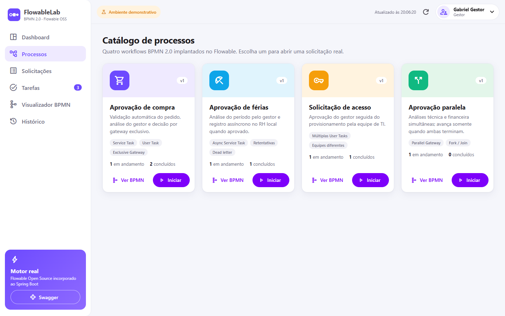 | 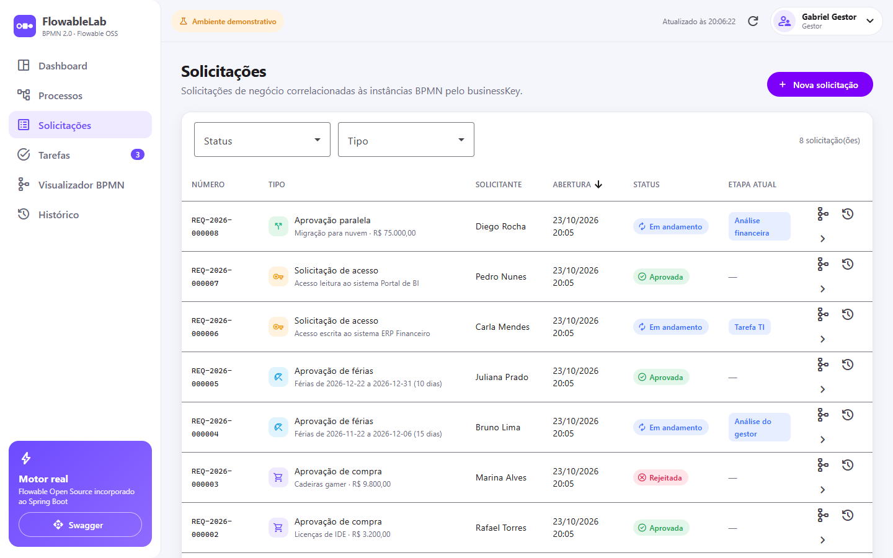 |

## 11. Como acessar o Swagger

- Swagger UI: **http://localhost:4200/swagger-ui.html**
- OpenAPI JSON: http://localhost:4200/v3/api-docs

A documentação é do Spring Boot e chega ao navegador pelo mesmo caminho da aplicação (Nginx → BFF → backend).
No modo de desenvolvimento ela também fica em http://localhost:8080/swagger-ui.html.

Exemplos prontos para o VS Code REST Client / IntelliJ estão em [docs/api-examples.http](docs/api-examples.http).

## 12. Como iniciar um processo

**Pela interface:** *Processos* → escolha o card → **Iniciar** → preencha o formulário → **Iniciar processo**.
A solicitação recebe um número (`REQ-AAAA-NNNNNN`), usado como `businessKey` da instância, e você é levado
para a página de detalhes.

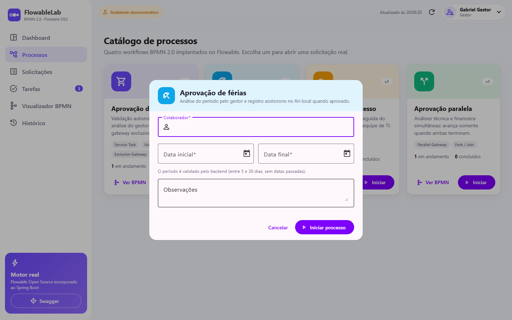

**Pela API:**

```bash
curl -X POST http://localhost:4200/api/process-instances \
  -H "Content-Type: application/json" -H "X-Demo-User: colaborador" \
  -d '{"processKey":"purchaseApproval","requester":"Ana Souza","description":"Notebooks","amount":18500,"justification":"Renovação"}'
```

<details>
<summary>PowerShell</summary>

```powershell
$body = @{ processKey='purchaseApproval'; requester='Ana Souza'; description='Notebooks'; amount=18500 } | ConvertTo-Json
Invoke-RestMethod -Method Post http://localhost:4200/api/process-instances `
  -ContentType 'application/json' -Headers @{ 'X-Demo-User'='colaborador' } -Body $body
```
</details>

Valores de `processKey`: `purchaseApproval`, `vacationApproval`, `accessRequest`, `parallelApproval`.

## 13. Como aprovar ou rejeitar tarefas

**Pela interface:** selecione o perfil responsável no cabeçalho → *Tarefas* → **Aprovar**, **Rejeitar** ou
**Concluir**. A rejeição exige justificativa. Depois da operação, a solicitação, as tarefas, o histórico, o
diagrama e os indicadores são atualizados automaticamente. Também é possível agir pela aba *Geral* dos detalhes.

**Pela API:**

```bash
# listar tarefas do gestor
curl "http://localhost:4200/api/tasks?assignee=gestor"

# rejeitar (o comentário é obrigatório)
curl -X POST http://localhost:4200/api/tasks/<taskId>/complete \
  -H "Content-Type: application/json" -H "X-Demo-User: gestor" \
  -d '{"action":"REJECT","comment":"Fora da política de compras"}'
```

O backend valida o perfil (403 se não for do grupo da tarefa), a ação permitida para o tipo de tarefa (422),
a justificativa na rejeição (422) e tarefas já concluídas (409).

## 14. Como visualizar o BPMN

*Visualizador BPMN* → escolha uma **instância** (estado real de execução) ou uma **definição** (somente o fluxo).

- O XML vem do backend (`GET /api/process-definitions/{id}/diagram`), na **versão exata** usada pela instância.
- 🔵 Ativa · 🟢 Concluída · 🔴 Falha · ⚪ Ainda não executada. Os sequence flows percorridos também ficam verdes.
- Zoom (botões ou roda do mouse), arraste para mover e **ajustar à tela**.
- Clique em um elemento para ver tipo, status, horários, duração e responsável.

O destaque usa **apenas o histórico real** do Flowable: o ramo não escolhido de um gateway nunca é marcado, a
junção paralela fica ativa enquanto espera o outro ramo, e elementos executados mais de uma vez recebem um contador.

| Falha real em Service Task assíncrona (dead letter) | Aprovação de compra (definição) |
|---|---|
| 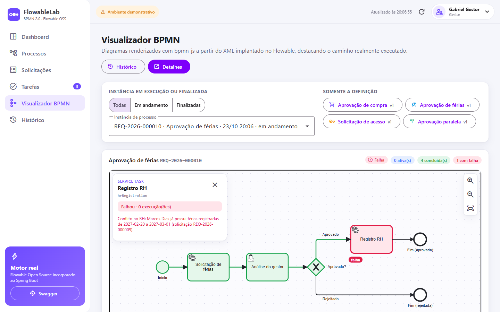 | 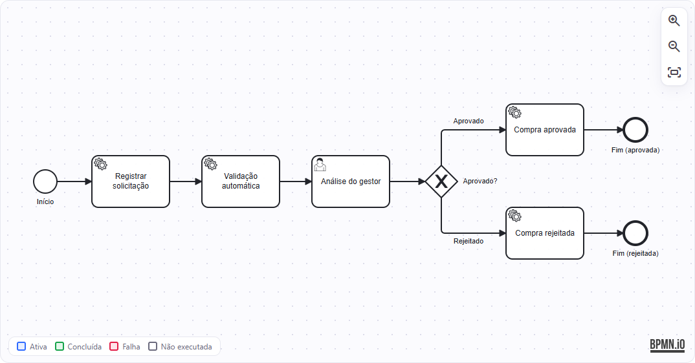 |

> Para ver uma falha real: aprove duas solicitações de férias **sobrepostas** para o mesmo colaborador. O
> `Registro RH` detecta o conflito, o Flowable faz as retentativas configuradas no BPMN e o job vai para a fila
> de dead letter; a etapa fica vermelha e a solicitação vai para `FAILED`.

## 15. Como consultar o histórico

*Histórico* → selecione a instância. A timeline mostra início, cada atividade executada, responsáveis,
decisões e comentários, datas/horários, durações e o resultado final. **Clique em um item para destacá-lo no
diagrama** ao lado. O mesmo recurso está na aba *Histórico* dos detalhes.

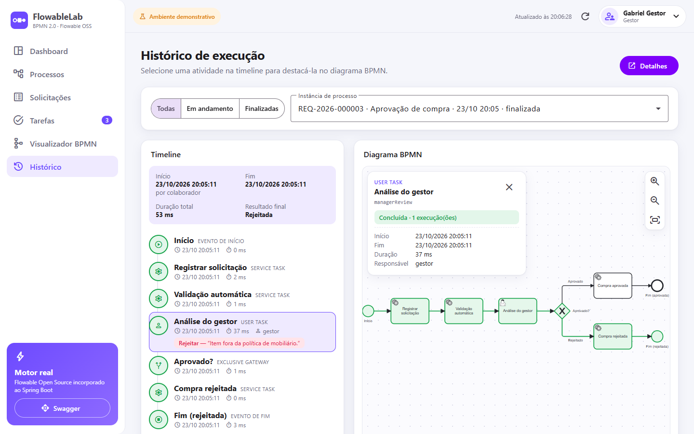

API: `GET /api/history/processes/{id}`, `/activities` e `/tasks`.

## 16. Como executar os testes

Os testes de integração usam **Testcontainers** e precisam de um Docker em execução.

```bash
# Backend — requer JDK 25 (o Maven vem pelo wrapper)
cd backend && ./mvnw verify            # Windows: mvnw.cmd verify

# Frontend — com Docker
docker run --rm -v "$PWD/frontend":/app -w /app node:24-alpine sh -c "npm ci && npm run test:ci"

# Frontend — com Node 24 local
cd frontend && npm ci && npm run test:ci

# BFF — com Node 24 local (proxy testado contra um backend HTTP de teste, sem Flowable)
cd bff && npm ci && npm test

# Regressão funcional pela cadeia completa (requer `docker compose up` em execução)
cd bff && REGRESSION_BASE_URL=http://localhost:4200 npm run test:regression
```

O que é coberto:

- **Backend (42 testes)**: regras de domínio, cálculo do caminho executado, casos de uso com Mockito e
  integração real (Flowable + PostgreSQL) cobrindo início de processos, Service Tasks, criação de User Tasks,
  aprovação/rejeição, transições de gateways, junção paralela, job assíncrono em dead letter, histórico,
  conclusão de processos e respostas de erro da API.
- **Frontend (31 testes)**: serviços HTTP, interceptor, Signals, formulários, componentes, tratamento de erros e
  renderização dos estados BPMN.
- **BFF (33 testes)**: encaminhamento de GET/POST/PUT/PATCH/DELETE, path, query strings repetidas, corpo,
  cabeçalhos (`X-Demo-User`, `Authorization`, correlação), status 201/204, erros 400/401/403/404/409/422/500,
  XML BPMN byte a byte, backend indisponível (502), timeout (504), ausência de retries e validação da configuração.
- **Regressão via BFF (5 cenários)**: compra (A), paralelo com junção (B), férias assíncronas (C), acesso por
  equipes (D) e visualização BPMN de instâncias ativa e finalizada (E). Cada resposta é conferida pelo
  `X-Correlation-Id`, que só o BFF devolve — comprovando que a chamada passou pela nova camada.

O GitHub Actions ([ci.yml](.github/workflows/ci.yml)) roda as três suítes, os builds de produção e, por fim,
sobe o `docker compose` completo, verifica que o backend não está exposto e executa a regressão via BFF.

## 17. Como consultar os logs

```bash
docker compose logs -f backend          # backend (Spring Boot + Flowable)
docker compose logs -f bff              # BFF NestJS (uma linha JSON por requisição)
docker compose logs -f frontend         # Nginx
docker compose logs -f postgres
docker compose logs --tail 200 backend | grep "pid:"   # linhas com processInstanceId
```

As linhas registradas durante operações de workflow trazem o identificador da instância:
`INFO [pid:6b8ab4ab-...] ... Tarefa 'Análise do gestor' concluída por gestor com a ação APPROVE`.

## 18. Como reiniciar o ambiente

```bash
docker compose restart                 # reinicia os contêineres (dados preservados)
docker compose down && docker compose up -d   # recria os contêineres (dados preservados)
docker compose up --build -d           # após alterar o código
```

Os dados ficam no volume `postgres-data`. A carga demonstrativa é **idempotente**: reiniciar não duplica dados,
e os BPMN não geram nova versão se não mudaram.

## 19. Como limpar os dados demonstrativos

Para apagar **tudo** (instâncias, histórico, solicitações) e recomeçar com exemplos novos:

```bash
./scripts/reset.sh                                     # Linux / macOS / Git Bash
powershell -ExecutionPolicy Bypass -File scripts\reset.ps1     # Windows

# ou manualmente
docker compose down -v && docker compose up --build -d
```

Para iniciar **sem** exemplos, defina `DEMO_DATA_ENABLED=false` no `.env` antes do `down -v` / `up`.

Dados criados na primeira inicialização (todos executando os processos reais pelo Flowable): compra aguardando
aprovação, compra aprovada, compra rejeitada, férias pendentes, férias aprovadas (concluídas pelo Registro RH
assíncrono), acesso aguardando a TI, acesso concluído e aprovação paralela com a análise técnica concluída e a
financeira pendente.

## 20. Limitações de segurança do MVP

> ⚠️ **Este projeto não possui autenticação de produção e não deve ser exposto publicamente.**

- O seletor de perfil e o cabeçalho `X-Demo-User` são **apenas demonstrativos**: qualquer cliente pode enviar
  qualquer valor. O backend valida a elegibilidade para a tarefa, mas isso **não** é controle de acesso.
- Não há JWT, OAuth2, HTTPS, CSRF, rate limiting nem auditoria de identidade.
- O Swagger fica acessível pelo frontend para fins didáticos. No modo de desenvolvimento, backend, BFF e
  PostgreSQL também são publicados no host.
- O BFF repassa o `X-Demo-User` sem interpretá-lo; toda a validação de perfis continua no Spring Boot.
- As credenciais de `.env.example` são exclusivas do ambiente local.

Para qualquer uso fora de uma máquina local seria preciso, no mínimo: um provedor de identidade
(Spring Security + OAuth2/OIDC) com os grupos vindos do token, TLS, remoção das portas do banco e do Swagger, e
segredos gerenciados.

---

## BFF NestJS

O BFF (`bff/`) é uma camada **transparente** entre o Angular e o Spring Boot. Nesta versão ele não agrega,
adapta nem autentica nada; apenas encaminha, observa e protege contra falhas de comunicação. A estrutura
(um controller de proxy com rotas `@All`) permite acrescentar no futuro controllers próprios de agregação ou
autenticação, sem alterar o backend.

**Estratégia de proxy**

- Um único `ProxyController` (`@All`) cobre `/api/*`, `/swagger-ui*` e `/v3/api-docs*` — não há endpoints duplicados.
- O encaminhamento usa `node:http` com **streaming** nos dois sentidos e o body parser do Nest desligado: JSON,
  XML BPMN, Problem Details, `201` com `Location`, `204` e respostas vazias passam sem conversão.
- Método, path, query string (inclusive parâmetros repetidos) e cabeçalhos fim a fim — `Content-Type`,
  `Authorization`, `X-Demo-User`, `Host` — são preservados; apenas cabeçalhos hop-by-hop são removidos.
- **Sem retries**: início de processo e conclusão de tarefa nunca são reenviados automaticamente.
- Backend inacessível → `502`; sem resposta em `PROXY_TIMEOUT_MS` → `504`. Ambos em Problem Details, sem detalhes internos.
- `X-Correlation-Id`: reutiliza o recebido ou gera um UUID, envia ao Spring Boot e devolve ao navegador.
- Log JSON por requisição com método, rota (sem query string), status, duração e correlação — sem corpos nem cabeçalhos.

**Endpoints próprios** (não encaminhados):

| Endpoint | Uso |
|---|---|
| `GET /bff/health` | Liveness, usado pelo health check do Docker |
| `GET /bff/health/ready` | Readiness: verifica se o BFF alcança o `/actuator/health` do backend |

**Como verificar que o Angular consome exclusivamente o BFF**

1. `docker compose ps` — apenas `flowablelab-frontend` publica porta; `curl http://localhost:8080` não responde.
2. No navegador (DevTools → Network), todas as chamadas vão para `http://localhost:4200/api/...` e trazem o
   cabeçalho de resposta `x-correlation-id` (o Spring Boot não o emite).
3. Envie um identificador e localize-o no log do BFF:

   ```bash
   curl -s -H "X-Correlation-Id: teste-bff-1" http://localhost:4200/api/dashboard/summary
   docker compose logs bff | grep teste-bff-1
   ```

**Como diagnosticar falhas no BFF**

| Sintoma | Verificação |
|---|---|
| Telas mostram "Serviço de processos indisponível" (502) | `docker compose exec bff wget -qO- http://127.0.0.1:3000/bff/health/ready` e `docker compose logs backend` |
| "Tempo de resposta esgotado" (504) | O backend demorou mais que `PROXY_TIMEOUT_MS`; veja `docker compose logs bff` (mensagem `timeout do backend`) |
| `bff` não fica `healthy` | `docker compose logs bff` — configuração inválida (`BACKEND_URL`, `PORT`, `PROXY_TIMEOUT_MS`) interrompe a inicialização com mensagem explícita |
| Requisição sem resposta esperada | Pegue o `x-correlation-id` da resposta no navegador e procure-o em `docker compose logs bff` |

## Os quatro workflows

<table>
<tr><td width="50%">

**1. Aprovação de compra** — `purchaseApproval`<br/>
Registrar solicitação → **Validação automática** (Service Task: valida e define a prioridade) →
**Análise do gestor** (User Task) → **Exclusive Gateway** → Compra aprovada (gera pedido `PO-…`) ou
Compra rejeitada (registra o motivo).

</td><td></td></tr>
<tr><td>

**2. Aprovação de férias** — `vacationApproval`<br/>
Solicitação de férias → Análise do gestor → aprovado: **Registro RH** (Service Task **assíncrona** com
retentativas, grava no RH local e recusa períodos sobrepostos) → Fim; rejeitado → Fim.
Regras: data final ≥ inicial, entre 5 e 30 dias, sem início no passado.

</td><td>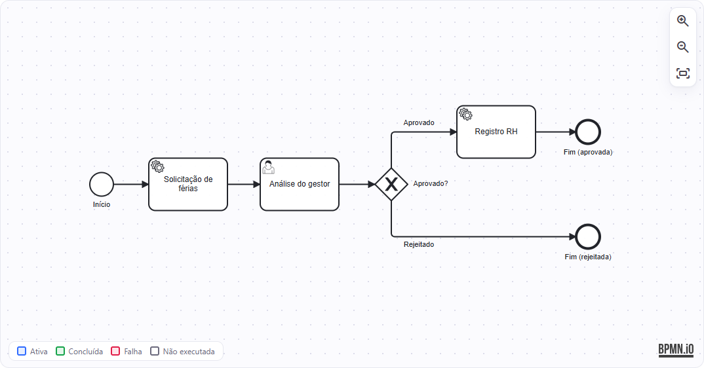</td></tr>
<tr><td>

**3. Solicitação de acesso** — `accessRequest`<br/>
Solicitar acesso → Análise do **gestor** → aprovado: **Tarefa TI** (outra equipe) → **Conceder acesso**
(Service Task que registra a concessão) → Fim. O histórico mostra os dois responsáveis.

</td><td>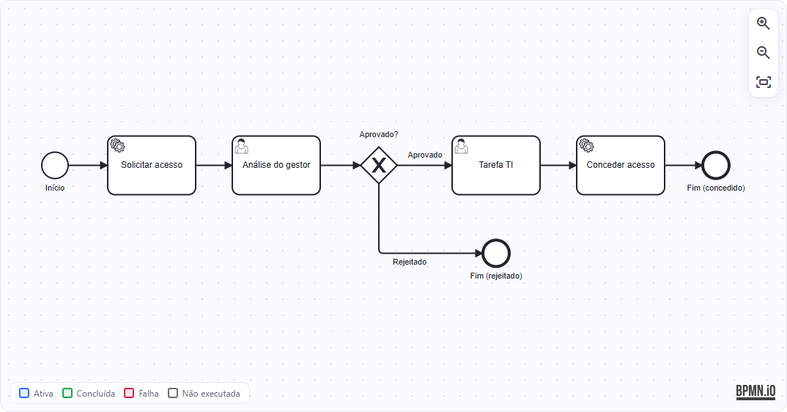</td></tr>
<tr><td>

**4. Aprovação paralela** — `parallelApproval`<br/>
Abrir solicitação (colaborador) → **Parallel Gateway** → Análise técnica (TI) ‖ Análise financeira (gestor) →
**junção** (espera as duas) → Consolidar análises (aprovada só se ambas aprovarem) → Fim.

</td><td>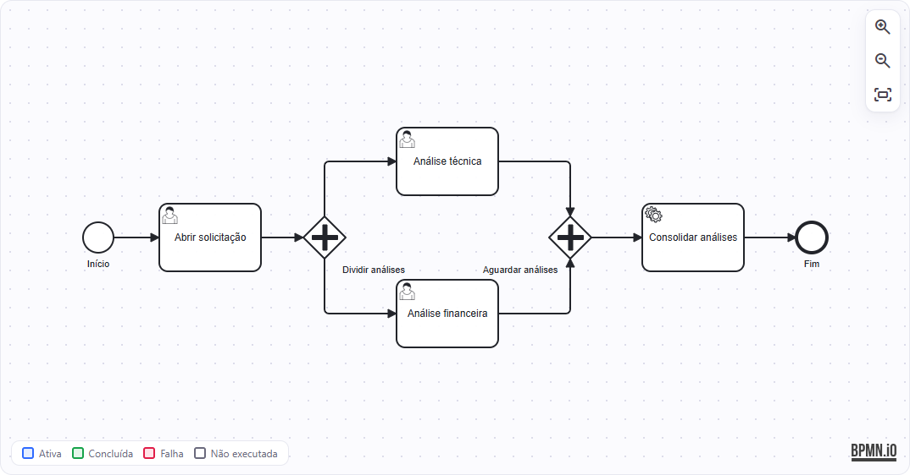</td></tr>
</table>

## API REST

| Método | Endpoint | Descrição |
|---|---|---|
| GET | `/api/process-definitions` · `/{id}` · `/{id}/diagram` | Definições implantadas e XML BPMN exato |
| POST | `/api/process-instances` | Abre solicitação e inicia o processo (`processKey`) |
| GET | `/api/process-instances` · `/{id}` | Instâncias paginadas (filtros `processKey`, `finished`, `businessKey`) e detalhes |
| GET | `/api/process-instances/{id}/activities` | Caminho executado + estado de cada elemento |
| GET | `/api/process-instances/{id}/variables` | Variáveis de processo |
| GET | `/api/tasks` · `/{id}` | Tarefas por responsável (`assignee`), processo e status (`PENDING`/`COMPLETED`) |
| POST | `/api/tasks/{id}/complete` | `APPROVE`, `REJECT` ou `COMPLETE` (+ `comment`) |
| GET | `/api/history/processes/{id}` · `/activities` · `/tasks` | Histórico |
| GET | `/api/requests` · `/{id}` | Solicitações com filtros (`status`, `type`), paginação e ordenação |
| GET | `/api/dashboard/summary` · `/process-status` · `/process-types` | Indicadores |
| GET | `/api/users` | Perfis demonstrativos |

## Tratamento de erros

Todas as respostas de erro seguem **Problem Details (RFC 9457)**, sem stack traces:

| Situação | HTTP | `title` |
|---|---|---|
| Campos inválidos (Bean Validation) | 400 | Dados inválidos (com lista `errors`) |
| Usuário fora do grupo da tarefa | 403 | Usuário não autorizado para a tarefa |
| Processo, instância, tarefa ou definição inexistente | 404 | Processo inexistente / Recurso não encontrado |
| Tarefa já concluída · atualização concorrente | 409 | Tarefa já concluída · Atualização concorrente |
| Regra de negócio · ação inválida · rejeição sem justificativa | 422 | Regra de negócio violada · Ação inválida para a tarefa |
| Falha em Service Task síncrona (transação desfeita) | 500 | Falha na execução do processo |
| Banco de dados indisponível | 503 | Banco de dados indisponível |

## Solução de problemas

| Sintoma | Solução |
|---|---|
| Porta 4200 em uso | Altere `FRONTEND_PORT` no `.env` |
| Porta 5433, 8080 ou 3000 em uso (modo dev) | Altere `POSTGRES_PORT`, `BACKEND_PORT` ou `BFF_PORT` no `.env` |
| Erros 502/504 nas telas | Veja [Como diagnosticar falhas no BFF](#bff-nestjs) |
| `backend` demora para ficar `healthy` | Normal no primeiro start (criação do schema do Flowable); veja `docker compose logs -f backend` |
| Windows: `docker` não encontrado | Inicie o Docker Desktop e use o backend WSL 2 |
| Testes do backend falham ao iniciar o contêiner | O Testcontainers precisa do Docker em execução |
| Erro `PKIX path building failed` ao rodar o Maven localmente | Antivírus/proxy com inspeção TLS: adicione o certificado ao JDK ou, no Windows, use `MAVEN_OPTS=-Djavax.net.ssl.trustStoreType=Windows-ROOT` |

## Licença

[MIT](LICENSE). Flowable, Spring, Angular, bpmn-js e demais dependências pertencem aos respectivos autores e
são distribuídos sob suas próprias licenças de código aberto.
