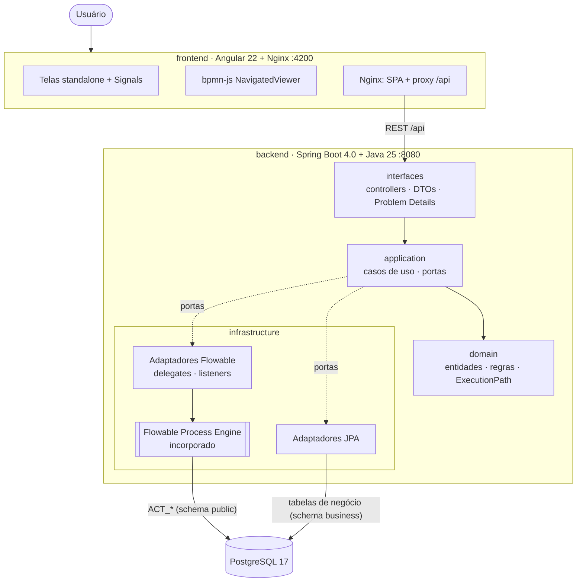
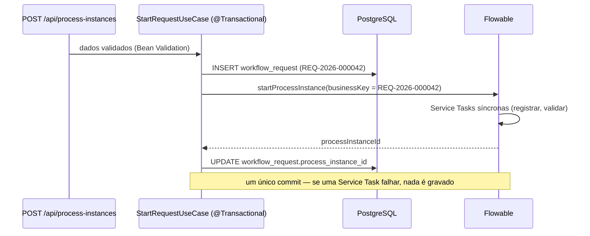

# Arquitetura do FlowableLab

Este documento detalha as decisões técnicas do projeto. Para instalação e uso, veja o [README](../README.md).

## Visão geral

## Camadas (arquitetura hexagonal)

| Camada | Pacote | Responsabilidade | Depende de |
|---|---|---|---|
| Domain | `com.flowablelab.domain` | Solicitações, dados de cada processo com validação, regras de tarefa (`TaskRules`), perfis demonstrativos, cálculo do caminho executado (`ExecutionPath`) | nada (Java puro) |
| Application | `com.flowablelab.application` | Casos de uso (`StartRequestUseCase`, `CompleteTaskUseCase`, consultas) e **portas de saída** (`ProcessEnginePort`, `TaskPort`, repositórios) | domain |
| Infrastructure | `com.flowablelab.infrastructure` | Adaptadores do Flowable (serviços oficiais), delegates das Service Tasks, listeners, JPA/Flyway, carga demonstrativa | application, domain, Flowable, Spring Data |
| Interfaces | `com.flowablelab.interfaces` | Controllers REST, DTOs de entrada/saída, `GlobalExceptionHandler` (RFC 9457) | application, domain |

Nenhuma classe de domínio importa `org.flowable.*`. O único ponto de contato com o motor são os adaptadores
`FlowableProcessEngineAdapter` e `FlowableTaskAdapter`, os delegates e os listeners — todos em `infrastructure.flowable`.

As portas de entrada não foram modeladas como interfaces: os casos de uso são classes concretas,
para evitar abstrações sem benefício real neste projeto educacional.

## Integração com o Flowable

- **Motor incorporado**: `flowable-spring-boot-starter-process` 8.0.0 cria o `ProcessEngine` no mesmo processo do Spring Boot.
  Não há contêiner nem servidor Flowable separado.
- **Serviços oficiais**: `RuntimeService` (início, execuções), `RepositoryService` (definições e XML),
  `TaskService` (User Tasks), `HistoryService` (histórico, variáveis), `ManagementService` (jobs com falha),
  `IdentityService` (usuário autenticado no início do processo).
- **Nenhum acesso direto** a tabelas `ACT_RU_*` / `ACT_HI_*`.
- **Implantação**: arquivos `src/main/resources/processes/*.bpmn20.xml` são implantados automaticamente com
  filtragem de duplicatas — reiniciar não cria novas versões; alterar um BPMN cria uma nova versão, e instâncias
  antigas continuam exibindo o XML exato da versão em que foram iniciadas.
- **Verificação**: `ProcessDeploymentVerifier` interrompe a inicialização se alguma das quatro definições não existir.
- **Histórico**: `flowable.history-level=full`, necessário para atividades, decisões, variáveis e sequence flows.

## Correlação e consistência transacional

- O Flowable e o JPA compartilham o mesmo `DataSource` e o `JpaTransactionManager` do Spring.
- `businessKey` = número da solicitação; o `processInstanceId` fica gravado na solicitação.
- O **desfecho** é gravado por um execution listener nos End Events
  (`${requestOutcome.record(execution, 'APPROVED')}`), dentro da transação do motor.
- **Falhas assíncronas**: a Service Task `Registro RH` é `flowable:async="true"` com
  `failedJobRetryTimeCycle R2/PT5S`. Esgotadas as tentativas, o job vai para a fila de *dead letter*; o
  `JobFailureListener` (evento `JOB_MOVED_TO_DEADLETTER`) marca a solicitação como `FAILED`.
- Os logs incluem o `processInstanceId` via MDC (`[pid:...]`).

## Como o visualizador sabe o que destacar

`GET /api/process-instances/{id}/activities` devolve as execuções do `HistoryService` e o estado consolidado
por elemento, calculado no domínio por `ExecutionPath.summarize`:

1. Só recebem marcação elementos que **aparecem no histórico** — nada é inferido pela ordem do fluxo.
2. **FAILED** (job com exceção ou em dead letter) tem precedência sobre ACTIVE, que tem precedência sobre COMPLETED.
   Um elemento em loop que voltou a executar aparece ativo, nunca concluído.
3. Execuções paradas no runtime (`RuntimeService.createExecutionQuery`) mantêm ativo um **Parallel Gateway de
   junção** que ainda aguarda ramos (o Flowable encerra o registro histórico do ramo que já chegou).
4. Sequence flows realmente percorridos também são destacados, mostrando qual saída do gateway foi tomada.

No frontend, `markersFor()` apenas traduz esses estados em classes CSS aplicadas com `canvas.addMarker` do bpmn-js,
usando os IDs reais do XML.

## Persistência

| Schema | Conteúdo | Gerenciado por |
|---|---|---|
| `public` | Tabelas `ACT_*` (definições, execuções, tarefas, variáveis, histórico, jobs) | Flowable (`database-schema-update=true`) |
| `business` | `workflow_request`, `hr_vacation_record`, `access_grant`, sequência de números | Flyway (`db/migration`) |

## Frontend

- Componentes standalone, `ChangeDetectionStrategy.OnPush`, aplicação zoneless (padrão do Angular 22).
- Estado com **Signals**: `DemoUserStore` (perfil), `RefreshStore` (versão global) e `rxResource` em cada tela.
  Após qualquer operação a versão é incrementada e solicitações, tarefas, histórico, diagrama e indicadores
  são consultados novamente. Não há polling.
- Control flow moderno (`@if`, `@for`, `@let`), Reactive Forms, Angular Material (tema M3) e CDK.
- Regras de negócio permanecem no backend; o frontend exibe as mensagens de Problem Details.
- Ícones Material Symbols servidos localmente (sem CDN).
